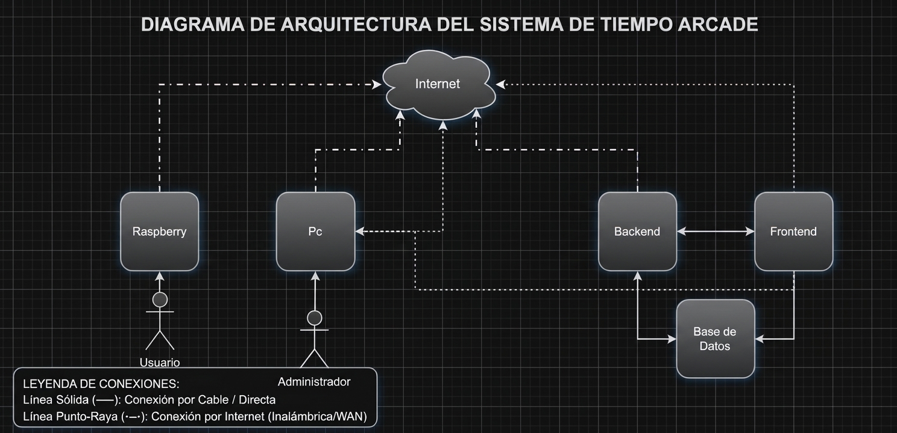

# Arcade Escolar

## Descripción

Proyecto desarrollado por estudiantes de la **ETEC-UBA** (Escuela Técnica de la Universidad de Buenos Aires).

Es una máquina arcade donde los **profesores** le cargan **tiempo de juego** a los **alumnos** desde una página web. El arcade, una Raspberry Pi con RetroPie, deja jugar solo mientras el alumno tenga tiempo disponible.

La idea es usar el tiempo de juego como premio: el alumno se registra, un profesor le asigna minutos y con esos minutos juega en el arcade.

### Diagrama de bloques



### Las partes

| Parte | Carpeta | Tecnología |
|---|---|---|
| Página web | `frontend/` | React + Vite |
| API | `backend/` | Python + Flask |
| Base de datos | — | PocketBase |
| Arcade | `raspberry/` | Python + pygame (RetroPie) |

Todo menos el arcade corre en **Docker** dentro de una máquina virtual del colegio (`10.56.31.32`). Solo se accede desde la red del colegio.

La base de datos (PocketBase) guarda tres tablas: **Personas**, **Estudiantes** (con el tiempo restante en segundos) y **Profesores**. Las contraseñas se guardan encriptadas. Los datos y el usuario administrador están en la carpeta compartida de Drive "Arcade > Pocket base"; ese material **no se sube a GitHub**.

---

## Install

### Probarlo en tu computadora (para desarrollar)

Hacen falta **dos terminales** abiertas al mismo tiempo, una para la base de datos y otra para la API.

Antes, en la carpeta `backend`, crear el archivo `.env` con los datos del administrador de PocketBase:

```env
mail_admin="tu-mail-de-super-user"
passwor_admin="contraseña"
```

**Terminal 1: base de datos (PocketBase)**

En este repositorio está la carpeta `pocketbase/pb_migrations`, que define la estructura de las tablas. Los datos reales y el usuario administrador **no están en GitHub**: están en la carpeta compartida de Google Drive **"Arcade > Pocket base"**, que tiene:

- `pb_data`: la base de datos con los datos.
- `pb_migrations`: la estructura de las tablas. PocketBase las crea solo al arrancar. Es la misma que está en el repositorio.
- `usuario`: el usuario y la contraseña del administrador (la misma que va en el `.env`).

Pasos: bajar `pocketbase.exe` desde pocketbase.io, ponerlo en una carpeta junto con `pb_data` y `pb_migrations` (si no tenés `pb_data`, arranca vacía y crea una base nueva), y desde esa carpeta:

```powershell
.\pocketbase.exe serve
```

Queda andando en `http://127.0.0.1:8090`. El panel de administración está en `http://127.0.0.1:8090/_/`.

**Terminal 2: API (Flask)**

```powershell
cd backend
.\venv\Scripts\Activate.ps1
pip install -r requirements.txt
python app.py
```

En Linux o Mac, para activar el entorno virtual se usa `source venv/bin/activate`. Si la carpeta `venv` no existe, crearla antes con `python -m venv venv`.

**Página web (opcional, una tercera terminal)**

```powershell
cd frontend
npm install
npm run dev
```

### Deploy en el servidor

En la máquina virtual (si no abre, hay que prenderla desde el vSphere Client):

```bash
git clone https://github.com/lianleyenda/Arcade
cd Arcade
```

**1. Base de datos.** Levantar PocketBase en el puerto 8090 usando los archivos `pb_data` y `pb_migrations` de la carpeta de Drive "Arcade > Pocket base". Los datos tienen que quedar en un volumen de Docker o en una carpeta de la máquina, así no se pierden si se borra el contenedor. Para administrarla: `http://10.56.31.32:8090/_/`.

**2. API.** Crear el archivo `backend/.env` con el email y la contraseña del administrador de PocketBase:

```
mail_admin=EMAIL_DEL_ADMIN
passwor_admin=CONTRASENA_DEL_ADMIN
```

(Así se llaman las variables, con ese error de ortografía. El `.env` **no se sube a GitHub**.) Después:

```bash
cd backend
sudo docker build -t backend-arcade .
sudo docker run -d --name backend-arcade --restart unless-stopped --env-file .env -p 5000:5000 backend-arcade
```

**3. Página web.**

```bash
cd frontend
npm install
npm run build
sudo docker build -t frontend-arcade .
sudo docker run -d --name frontend-arcade --restart unless-stopped -p 8085:80 frontend-arcade
```

Ahora la página está en `http://10.56.31.32:8085` y el registro de alumnos en `/registro`.

**4. Arcade.** En la Raspberry (usuario `pi`), copiar `raspberry/mensaje_saldo.py` a `/home/pi/ovelary/` y dejarlo llamado desde `/opt/retropie/configs/all/autostart.sh`. La dirección del servidor está escrita dentro del script; si cambia la IP, hay que cambiarla ahí.

### Comprobar que está andando

```bash
sudo docker ps
```

Tienen que aparecer `pocketbase`, `backend-arcade` y `frontend-arcade`. Si alguno no está: `sudo docker start NOMBRE`.

---

## How to?

Manual de usuario completo (alumno, profesor y arcade): [`docs/manual-de-usuario.md`](docs/manual-de-usuario.md)

Resumen:

1. **El alumno** se registra desde el celular en `http://10.56.31.32:8085/registro` con nombre, apellido, email y contraseña.
2. **El profesor** entra a su panel, busca al alumno y le asigna o le quita tiempo.
3. **En el arcade**, el alumno escribe su email y contraseña con el teclado. La pantallita LCD muestra el tiempo que le queda.
4. Mientras juega, el tiempo se descuenta. Cuando llega a cero, el juego se cierra solo.

### Para tener en cuenta

- En la misma máquina virtual hay proyectos de otros grupos. No los toques. Por eso usamos el puerto 8085.
- El tiempo se guarda en segundos.
- Las pantallas de profesores están protegidas por una contraseña de acceso que se define en `frontend/src/App.jsx`. Conviene cambiarla.

---

## ToDo's

- Teclado en pantalla manejado con los botones del arcade, para no depender del teclado físico. Con usuario y contraseña cortos.
- Que la combinación de botones para salir de un juego lleve al login y no a la terminal.
- Mostrar el tiempo restante dentro del juego.
- Pasar la dirección del servidor y el intervalo de sincronización de la Raspberry a un archivo de configuración.
- Mover la contraseña de acceso de profesores fuera del código.
- Revisar los saldos viejos que quedaron guardados en minutos en lugar de segundos.

---

## Agradecimientos

- **Eduardo Mestrovich** y los docentes de la **E.T. N° 32**, por la donación del esqueleto de la consola.
- **Andrés Navarro**, por la donación del kit para el armado del arcade: palancas, botones y placa Zero Delay.
- **Joaquín Blanco**, por la donación del adaptador HDMI - RCA.
- **Julián Impelluso**, por la donación del televisor utilizado como pantalla.
